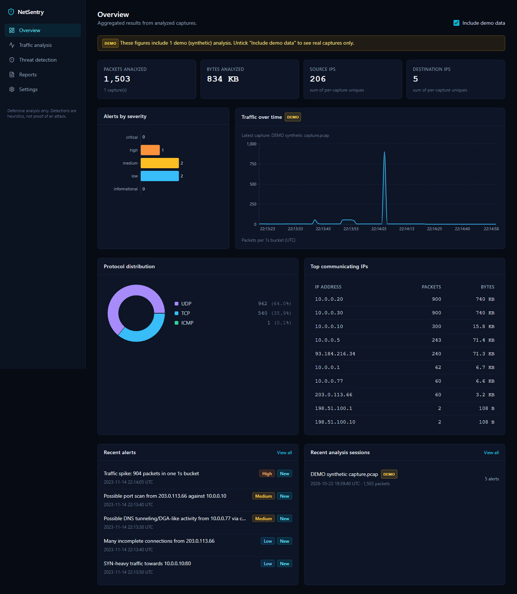
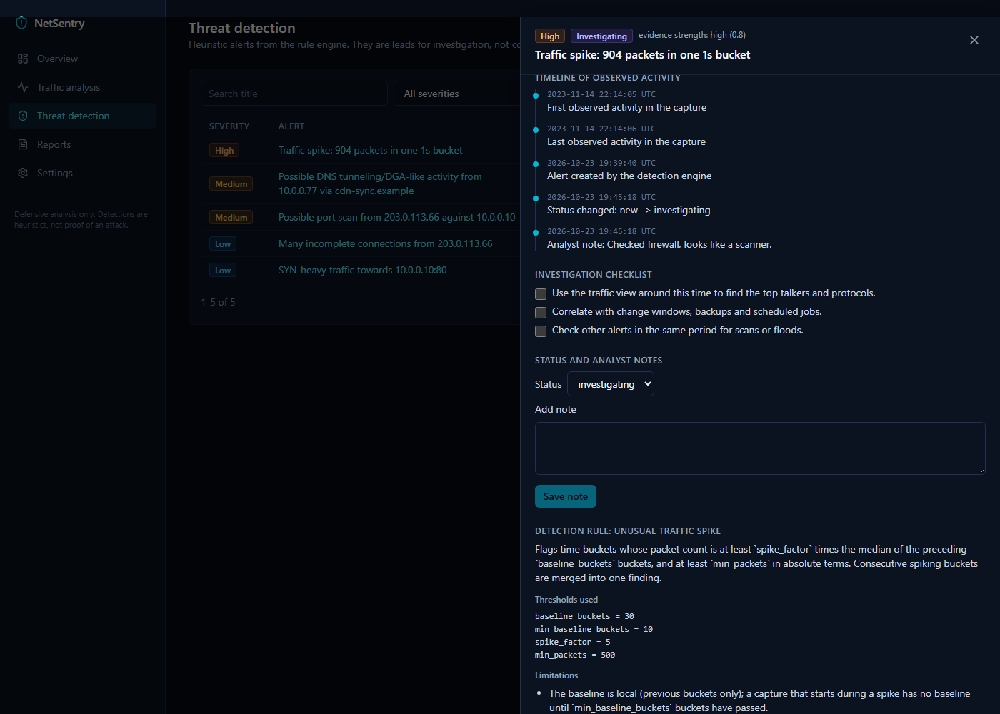
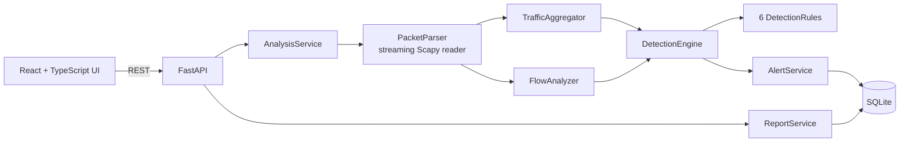

# NetSentry

Network traffic analysis and **explainable, rule-based threat detection** for offline PCAP/PCAPNG captures.

Upload a capture, see what is in it (protocols, talkers, ports, DNS, volume over time), and review heuristic alerts with evidence, possible benign explanations and investigation steps. Alerts carry a status and analyst notes, and every analysis can be exported as JSON, CSV or a readable HTML report.

> NetSentry is a defensive analysis tool. Detections are heuristics over packet headers and flow statistics, **not proof of an attack**. It reads files offline; it does not capture live traffic, scan, block or modify anything. It has **no authentication**: run it locally or behind your own access control (see [docs/security.md](docs/security.md)).

## Screenshots

| Overview (demo data, labeled) | Alert investigation |
|---|---|
|  |  |

Screenshots show the built-in **synthetic demo capture**, not real traffic.

## Features

- **Real packet analysis**: streaming PCAP/PCAPNG parsing with Scapy; handles empty, truncated, malformed and non-IP captures and reports what it skipped.
- **Traffic analysis**: packet/byte totals, protocol mix, top IPs and ports, TCP flags, ICMP types, DNS summary, volume over time, and a server-paginated, searchable packet-metadata table (a capture is never loaded into the browser).
- **Detection engine** with six independent, configurable rules: port scan / host sweep, repeated connections, SYN-heavy traffic, incomplete connections, traffic spikes, DNS anomalies. Every rule documents its limitations and false-positive risks ([docs/detection-rules.md](docs/detection-rules.md)).
- **Alert investigation**: evidence, timeline, checklist, status (`new` / `investigating` / `resolved` / `false_positive`) and analyst notes, persisted with an audit trail.
- **Reports**: JSON summary, alerts CSV (formula-injection safe), self-contained escaped HTML report. No packet payloads.
- **Settings**: thresholds, upload/packet limits, retention and UI preferences, validated by the backend.
- **Demo data is always labeled** and can be excluded from the dashboard.

## Architecture



Details: [docs/architecture.md](docs/architecture.md).

## Tech stack

Backend: Python 3.12, FastAPI, Scapy, Pydantic, SQLAlchemy + SQLite, Pytest, Ruff.
Frontend: React 18, TypeScript, Vite, Tailwind CSS, Recharts, Lucide, Vitest + Testing Library, ESLint, Prettier.
Delivery: Docker, Docker Compose, GitHub Actions.

## Quick start (Windows, PowerShell)

One command (builds the UI if needed, serves UI and API on one port):

```powershell
.\scripts\start.ps1   # then open http://127.0.0.1:8000
```

Development mode with hot reload (two terminals):

Prerequisites: Python 3.12+, Node.js 20+ (developed on 22), Git.

```powershell
git clone https://github.com/Yasine8710/netsentry.git
cd netsentry

# Backend (terminal 1)
cd backend
python -m venv .venv
.venv\Scripts\Activate.ps1
pip install -e ".[dev]"
uvicorn app.main:app --reload --port 8000

# Frontend (terminal 2)
cd frontend
npm install
npm run dev
```

Open http://localhost:5173. The Vite dev server proxies `/api` to the backend on port 8000. API docs: http://localhost:8000/docs.

Optional configuration: copy `.env.example` to `backend/.env` (variables are prefixed `NETSENTRY_`).

### Docker

```bash
docker compose up --build   # UI on http://localhost:8080 (bound to 127.0.0.1)
```

> The Docker files were written but not built or run in the development environment (Docker was not installed there). Treat them as unverified until you run them.

## Example workflow

1. Open **Traffic analysis** and drop in `data/samples/port_scan.pcap` (or click **Load demo data** on the Overview).
2. Review the summary, charts and packet table.
3. Open **Threat detection**, click the "Possible port scan" alert, read the evidence and benign explanations, work through the checklist.
4. Set the status to *investigating*, add a note.
5. Under **Reports**, download the HTML report to share findings.

Regenerate the sample captures (synthetic, local only) with `python scripts/generate_samples.py`.

## Testing

```powershell
cd backend;  .venv\Scripts\Activate.ps1; pytest -q; ruff check .; ruff format --check .
cd frontend; npm test; npm run lint; npm run format; npm run build
```

Last local run: backend 145 tests passed, frontend 24 tests passed; ruff, ESLint, Prettier, `tsc` and the production build were clean. CI (`.github/workflows/ci.yml`) runs the same checks.

## Detection rules (summary)

| Rule | Looks for | Key defaults |
|---|---|---|
| `port_scan` | One source probing many ports on a host or one port on many hosts without completed handshakes | 20 ports / 20 hosts in 60 s |
| `repeated_connections` | Many connections from one client to one service | 50 in 60 s |
| `syn_heavy` | Many SYNs to one destination with few completed handshakes | 200 SYNs in 10 s, completion <= 50% |
| `incomplete_connections` | A client whose attempts mostly show no completed handshake (skipped for one-directional captures) | 30 failed, >= 70% |
| `traffic_spike` | A bucket >= 5x the recent median and >= 500 packets | 30-bucket median baseline |
| `dns_anomaly` | High query rate, many NXDOMAIN, many long high-entropy subdomains of one domain | see docs |

Thresholds are configurable and validated; lower values find more activity and raise false positives. **Evidence strength** is how clearly the pattern exceeds the threshold, not the probability of malice. Encrypted traffic contents are never inspected, and "no reply observed" is never presented as a confirmed failure.

## Security considerations

Size limits enforced before buffering, magic-byte validation, generated temp filenames (user filenames never touch the filesystem), cleanup and retention, no payload storage, escaped reports, restricted CORS, no secrets in the repo. **No authentication**: do not expose publicly. Full list and residual risks: [docs/security.md](docs/security.md).

## Known limitations

- No authentication or multi-user support.
- Offline files only; no live capture.
- TCP-centric flow inference; UDP/ICMP scans are not detected; encrypted DNS is invisible.
- Analysis is synchronous (bounded by size, packet and time limits); very large captures are truncated and flagged, not queued.
- Per-analysis packet rows are capped (default 50k) for search; statistics and detections cover the full parsed capture.
- The Overview's unique-IP figures are the sum of per-capture uniques (an IP seen in two captures counts twice).
- No schema migrations yet (schema-version guard only).
- Detection quality has not been benchmarked against labeled datasets; no accuracy figures are claimed.
- Docker setup unverified (see above).

## Roadmap

- Authentication and per-user attribution of notes
- Background analysis queue with live progress
- Alembic migrations
- IPv6-aware and UDP/ICMP scan rules; beaconing detection
- Labeled-data evaluation harness; compare any future model against the rule baseline
- Optional PDF report; screenshots refresh in CI

## License

MIT. See [LICENSE](LICENSE).
