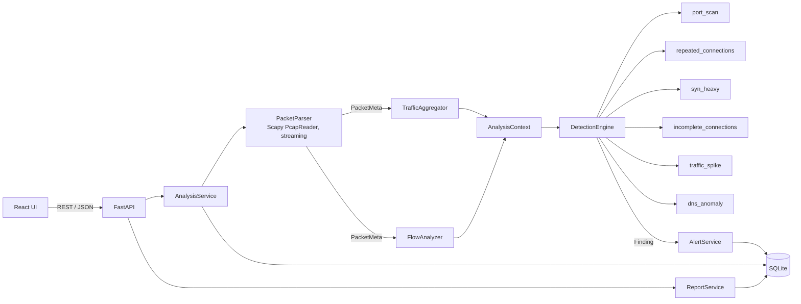

# Architecture

NetSentry analyzes **offline** PCAP/PCAPNG captures. It never touches live traffic and never blocks or modifies anything.

## Pipeline

1. **Upload** (`POST /api/analyses`): a size-limit middleware rejects oversized bodies before they are buffered. The service streams the file to a generated name (`<uuid>.upload`) in the upload directory, counting bytes again as defence in depth.
2. **Validate**: extension allow-list (`.pcap`, `.pcapng`, `.cap`) and magic bytes (`detect_format`). The user-supplied filename is only kept as a sanitized display label; it never touches the filesystem.
3. **Parse** (`PacketParser`): a lazy generator over Scapy's `PcapReader`. Each packet becomes an immutable `PacketMeta` (addresses, ports, protocol, length, TCP flags, ICMP type, DNS question). **Payloads are discarded.** Non-IP frames, packets without timestamps, malformed packets and truncated files are counted and reported, not fatal. Parsing stops at `max_packets` or the time limit and says so.
4. **Aggregate** (`TrafficAggregator`): bounded counters (`BoundedCounter`) for IPs and ports, a time series that doubles its bucket width when it would exceed 5000 buckets, per-source DNS statistics.
5. **Flows** (`FlowAnalyzer`): one bidirectional flow per 5-tuple (capped at 200k flows) with handshake evidence. Flow *outcome labels* describe what the capture shows (`handshake_observed`, `no_response_observed`, `reset_by_responder`, `partial_or_midstream`), not what truly happened.
6. **Detect** (`DetectionEngine`): each `DetectionRule` receives an `AnalysisContext` and validated parameters and returns `Finding`s. Output order is fully deterministic.
7. **Persist**: analysis, summary, aggregated stats, a capped set of packet-metadata rows, and alerts. The temporary file is deleted in a `finally` block.

Memory is bounded by: streaming parse, key caps on counters, the flow cap, the time-series cap, and the per-analysis packet-row cap. It is **not** bounded by capture size.

## Modules

| Path | Responsibility |
|---|---|
| `backend/app/analyzers/` | `PacketParser`, `TrafficAggregator`, `FlowAnalyzer`, `TimeSeries`, pipeline glue, synthetic capture generator |
| `backend/app/detectors/` | `DetectionRule` base, `DetectionEngine`, rule registry, one module per rule |
| `backend/app/services/` | `AnalysisService`, `AlertService`, `SettingsService` |
| `backend/app/reports/` | `ReportService` (JSON, CSV, HTML) |
| `backend/app/api/` | FastAPI router |
| `backend/app/models/` | SQLAlchemy tables |
| `backend/app/core/` | config, DB engine and init, body-size middleware |
| `frontend/src/` | pages, feature components, typed API client |

## Data model

`analyses` 1-1 `analysis_summaries`; 1-n `alerts`, `traffic_stats`, `packets`. `alerts` 1-n `alert_updates` (status changes and analyst notes: an audit trail). `rule_metadata` mirrors rule documentation (the code is the source of truth and is re-synced at startup). `app_settings` holds validated settings and the schema version. Foreign keys are enforced (`PRAGMA foreign_keys=ON`) with `ON DELETE CASCADE`.

### Schema initialization

`init_db()` runs `Base.metadata.create_all` (idempotent) and stores `schema_version` in `app_settings`. There are no migrations yet: when the schema changes incompatibly, bump `SCHEMA_VERSION`, add an Alembic migration, and the app refuses to start on a version mismatch rather than corrupting data.

## Retention

- Uploaded files: deleted immediately after analysis (and orphans older than one hour are swept).
- Analyses (with alerts, notes, packet rows): purged when older than `retention_hours` (default 720 h), at startup and before each upload.

## Design decisions

- **Rules over ML.** Transparent thresholds can be explained to an analyst. A learned model would need labeled data and a comparison against this baseline before it earns a place.
- **Synchronous analysis.** Simple and enough for offline files up to the configured limit; the request runs in a worker thread. A background queue is a roadmap item if captures grow.
- **Packet rows are capped** (default 50k per capture) so the UI can search and page server-side without loading a capture into the browser; statistics and detections always cover the full parsed capture.
